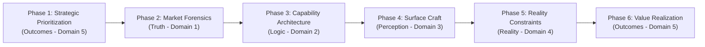

# ProductArchitectureKit Skill Specification & Operating Guide (v1.1.0)

## 1. The 5 Domains of Product Architecture

Every action in the product lifecycle strictly optimizes exactly one of these five mutually exclusive domains based on the specific entity being served. Any task falling outside these parameters is operational waste.

1. **Truth (Domain 1)**: Optimizes for the Human. Extracts revealed preferences from empirical market behavior, mitigating Desirability Risk (building what is not needed or relying on subjective stated opinions).
2. **Logic (Domain 2)**: Optimizes for the System. Structures invisible mathematics, routing, and information architecture, mitigating Utility Risk (building what is logically broken or dead-ended).
3. **Perception (Domain 3)**: Optimizes for the Surface. Renders logic into sensory interfaces, mitigating Aesthetic and Trust Risk (building what is cognitively heavy or unappealing).
4. **Reality (Domain 4)**: Optimizes for the Machine & Law. Enforces hardware limitations and legal accessibility compliance, mitigating Feasibility Risk (building what is physically impossible or illegal).
5. **Outcomes (Domain 5)**: Optimizes for the Business. Aligns software capabilities to the Business Model Canvas (BMC), mitigating Viability Risk (building what is unprofitable).

---

## 2. Layer 0: The Infrastructure Track (Immutable Architectural Laws)

Layer 0 operates permanently outside of sprint cycles as the mandatory input constraint for the Execution Pipeline, categorized by the Scale of System Resolution:

### 📁 Layer 0.1: Macro-Level Laws (Routing & Architecture)
- **Friction Budgets**: Core Use Cases must be mathematically achievable in $\le 3$ system decisions or steps.
- **The Reversibility Rule**: Zero logical dead-ends; every destructive action requires an explicit escape route or 'Undo' path.
- **State Persistence**: Interrupted workflows (user-driven or system-driven) must retain inputted data globally without forcing a restart.
- **Global Ontology**: Master Information Architecture Document (IAD) defining all cross-product navigation hierarchies and database relationships.

### 📁 Layer 0.2: Meso-Level Laws (Cognitive & Compositional)
- **Miller's Law**: Maximum 7 ($\pm 2$) distinct groups of information or parallel choices per view.
- **Hick's Law**: Maximum 1 primary Call-to-Action (CTA) per screen; secondary actions require progressive disclosure.
- **Gestalt Bounding**: Elements triggering related backend endpoints must share spatial proximity and a visual bounding container.
- **The Deviation Mechanism (Shatter Request)**: Meso-Level rules assume a Novice/Consumer user taxonomy. To bypass Layer 0.2 laws for Expert/Enterprise taxonomies, a formal Shatter Request must be approved, proving that enforcing whitespace would increase cognitive friction for the expert user.

### 📁 Layer 0.3: Micro-Level Laws (Perceptual & Sensory)
- **Spatial & Morphological (Geometry)**: 8pt grid alignments (`mod 8 == 0` or 4px micro-step), spatial padding tokens, $z$-index elevation, and Fitts's Law (minimum $44\times 44\text{px}$ interactive hit areas).
- **Chromatic & Optical (Surface)**: Semantic color hex codes (Red = Destructive only), gradients, and alpha-channel opacity.
- **Typographic & Glyphic (Language)**: Font scales, line heights, vector iconography rules, and character-length limits (max 60 chars per line for reading prose).
- **Kinetic & Temporal (Time)**: Animation durations, easing curves, interaction states (Hover, Active, Focus-visible), and visual response SLAs (feedback within $\le 100\text{ms}$).
- **Somatic & Auditory (Sensory)**: Haptic vibration frequencies and audio cues, paired with sensory exclusion laws (audio/haptics must always correspond to a visual GUI change).

### 📁 Layer 0.4: Meta-Level Laws (Regulatory & Machine)
- **Legal Accessibility (WCAG 2.1 AA)**: Unbreakable 4.5:1 optical contrast minimums, ARIA tagging, and keyboard tab-index sequencing.
- **Latency Budgets**: Any backend API call taking $> 400\text{ms}$ automatically mandates a visual skeleton loader to mitigate perceived system failure.
- **Data Privacy (GDPR/CCPA/Decree 13)**: Prohibits pre-checked consent states and pre-filled PII.

---

## 3. The 6-Phase Execution Pipeline (IPO Matrix)



- **Phase 1**: BMC Health Audit $\to$ Capability Gap Matrix $\to$ Baseline Telemetry $\to$ Prioritization Canvas $\to$ **🛑 Tollgate 1: UX Charter / Risk Waiver**.
- **Phase 2**: Ecological Mapping $\to$ Structural Autopsies & Tech Debt X-Ray $\to$ Convergence Synthesis $\to$ **🛑 Tollgate 2: Market Thesis Brief**.
- **Phase 3**: IA Tree $\to$ Logic Flow Diagrams $\to$ Structural Wireframes $\to$ Tri-Tier Negotiation $\to$ **🛑 Tollgate 3: Signed Logic Lock Ticket**.
- **Phase 4**: High-Fi Screens $\to$ Micro-copy & Interaction $\to$ Clickable Prototype $\to$ Heuristic Validation $\to$ **🛑 Tollgate 4: Friction Report (Pass/Fail)**.
- **Phase 5**: Edge Case Library $\to$ a11y Audit (WCAG) $\to$ Dev-Ready Specs $\to$ Handoff Ceremony $\to$ **🛑 Tollgate 5: Dev-Accepted Sprint Tickets**.
- **Phase 6**: Live QA $\to$ 30-Day Performance Telemetry $\to$ BMC Impact Assessment $\to$ Executive ROI Post-Mortem $\to$ **🛑 Tollgate 6: Formally Closed Project**.

---

## 4. Deterministic Code Engine ($P=1$): `layer0_validator.py`

Run mechanical validation across any frontend codebase:
```bash
python skills/ProductArchitectureKit/scripts.run_layer0_lint <path_to_ui_or_project>
```
Enforces:
1. Fitts's Law ($\ge 44\times 44\text{px}$ touch targets).
2. 8pt spatial grid (`mod 8 == 0` or 4px).
3. WCAG 2.1 AA 4.5:1 optical contrast ratio.
4. Hick's Law (max 1 primary CTA per view/drawer).
5. Miller's Law (max $7\pm 2$ items without grouping).
6. Skeleton loaders for async endpoints taking $> 400\text{ms}$.
7. Reversibility / escape routes for destructive actions.
8. Typography Governance Contract (`TypographyGovernanceContract`, `SPEC-TYPOGRAPHY-001`): `>= 11px` floor, `<= 3` custom font families, `<= 8` scale steps, zero arbitrary Tailwind text-size lengths, and zero `font-mono` buttons (with seamless directory/code delegation to `UIUXProMax/scripts/layer0_validator.py`).

---

## 5. Domain 3 Perception & Domain 4 Reality Rules: Dual-UI Luxury Asset Architecture

Governs high-touch UHNWI asset management, yachting CRM, private aviation, and luxury field-service platforms:

### 5.1 Dual-UI Operational Mode (80% Deck / 20% Desktop Split)
- **80% Deck 1-Tap Mode (Field Operatives $\le 768\text{px}$)**:
  - Minimum touch hit-target $\ge 48\times 48\text{px}$ (`deck-touch-target`).
  - High-sunlight optical contrast (WCAG AAA $\ge 7:1$) to guarantee readability on boat decks.
  - 1-tap fast incident capture, camera photo uploads, offline form queueing.
- **20% Desktop Governance Mode (Executive Office $\ge 1024\text{px}$)**:
  - 3-pane master-detail triage layout with sticky marine navy navigation canvas.
  - Cryptographic audit ledger inspection, multi-vessel fleet status, and warranty claim margin analysis ($\ge 30\%$).

### 5.2 Field-Level Security (FLS) VIP Masking & Quiet Luxury
- **Privacy Shield Token**: `--shield-bg: #2A2824; --shield-text: #E4C09F; border: 1px solid rgba(228,192,159,0.35);`.
- **Enforcement**: Sensitive yacht owner personal data (direct mobile numbers, private villa addresses, passport IDs) is cryptographically masked for non-executive and external shipyard roles, showing only vessel HIN and authorized operational contacts.

### 5.3 Brand Integrity Invariant
- **Zero Duplicate Brand Text**: When an official corporate wordmark image (e.g. sculpted serif logo) is rendered, plain text repeating the brand name within or adjacent to the brand container is strictly prohibited. Subtitles must strictly declare functional system scope (e.g. `After-Sales Platform` / `Hậu Mãi`).

### 5.4 Reusable Design Tokens Template
- **Source**: [`skills/UIUXProMax/templates/base/luxury_maritime_tokens.css`](file:///./skills/UIUXProMax/templates/base/luxury_maritime_tokens.css)
- **Descriptor**: [`skills/ProductArchitectureKit/resources/luxury_maritime_system.json`](file:///./skills/ProductArchitectureKit/resources/luxury_maritime_system.json)

---

## Overview & Purpose

`ProductArchitectureKit` operates as a governed socio-technical capability module under `LAYER0-STD`. **Objective**: Canonical owner of ProductArchitectureKit domain operations within the Antigravity 9-stage enterprise lifecycle.

## MECE Boundary & DRY Delegation Contract (`mece_demarcation_contract`)

- **Scope Demarcation**: Canonical owner of ProductArchitectureKit domain operations within the Antigravity 9-stage enterprise lifecycle.
- **DRY SSOT Invariant**: Zero duplicate business logic; shared persistence and telemetry delegate to `TaskManager` and `QualityGate`.
